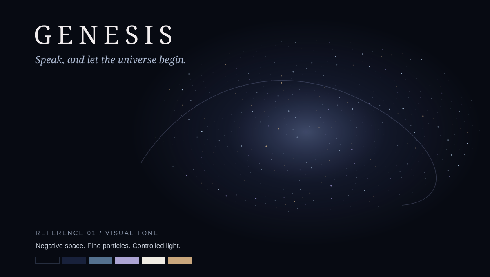
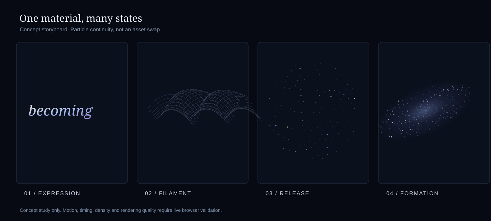
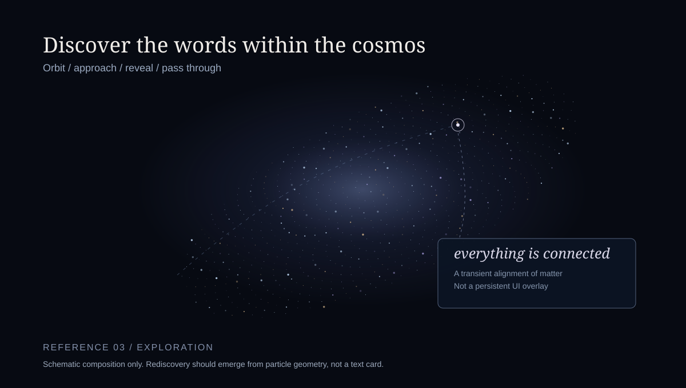

# Creative Direction — The Visual Language of Genesis

## Emotional premise
Human expression enters silence and becomes cosmological scale. The art should be intimate before it is immense. The feeling is **awe through restraint**, not sensory overload.

## Art direction
- **Void:** Near-black blue, not literal flat black everywhere. Negative space is intentional.
- **Light:** A few pristine highlights; bloom is a finishing tool, not a substitute for detail.
- **Color:** Begin with silver-white, cool celestial blue, faint violet and restrained warm gold; let AI select coherent variations later. No default rainbow.
- **Scale:** Small particles and immense spatial distributions, with depth and parallax.
- **Typography:** Elegant and legible before deformation; no generic sci-fi HUD font. Test high-quality licensed typefaces or custom vector outlines.
- **Movement:** Letters behave like filaments of ink suspended in a fluid, then form gravitationally suggestive structures. Deliberate acceleration, micro-turbulence, long arcs, stillness.
- **Audio:** Optional understated sound design; never essential for comprehension. Respect mute and reduced motion.
- **Camera:** Calm, physically suggestive easing; avoid uncontrolled rollercoaster moves.

## The hero transformation
1. **Emergence:** The real transcript coheres as legible glyphs in an almost empty scene.
2. **Activation:** Internal shimmer, edge filaments, deformation that does not compromise readability immediately.
3. **Release:** Glyph contours shed particles with continuous identities and velocity.
4. **Migration:** Curl-noise/flow-guided streams organize into a 3D spatial structure with meaningful density.
5. **Formation:** Galaxy arms, diffuse halo, core, subtle dust and navigable stars appear from the same material.
6. **Recognition:** At carefully chosen proximity/angle, spatial matter suggests the glyphs again. Not a crude toggle back to a flat text layer.

A single smooth lerp is a technical baseline, **not** the aesthetic solution. Explore flow fields, staged coherence, velocity continuity, occlusion, depth and illumination.

## Reference boards

The SVGs are original **design diagrams**, not realistic renders, finalized key art, or output claims.

## Rejection criteria
- Generic starfield screensaver, illegible text, obvious scene swap, oversaturated colors, uniform particle size, flat/unconvincing depth, excessive glare, jitter, lifeless linear motion.
- Effects that look compelling only from one locked camera without clear justification.
- AI-generated spectacle that does not preserve meaningful relation to the original words.

## Review vocabulary
Assess silhouette, hierarchy, contrast, pace, spatial depth, particle continuity, navigational feel, and emotional impact. Screenshot every phase at consistent seeds; record motion, because a still cannot prove a transition.
