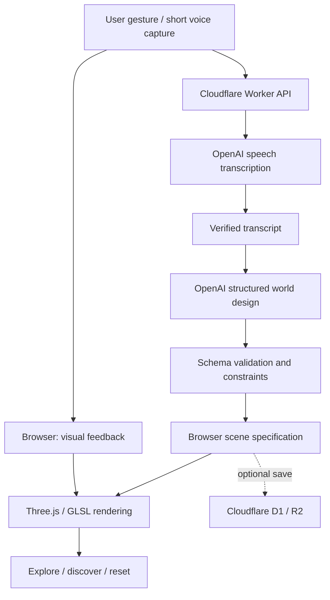

# Technical Architecture — Cloudflare-first

## Approach
Separate **real-time, deterministic browser graphics** from **asynchronous AI world direction**. AI must not gate 60 FPS animation or basic navigation.

## Client
- Vite + TypeScript + Three.js; evaluate React Three Fiber only if needed for maintainable view/UI composition.
- WebGL2 baseline, feature detection for future WebGPU optimization.
- Typography sampling: raster/outline glyph positions (appropriate licensing and language shaping), retain stable particle IDs and word association.
- Particle representation: GPU-friendly typed arrays/attributes, points/instancing, custom vertex/fragment shaders; consider GPU compute only when necessary and supported.
- Fields: curl noise, temporal advection, vortex/galactic distributions; interpolate **behavior** with velocity coherence, not only coordinates.
- Post effects: restrained bloom, tonemapping, exposure, appropriate anti-aliasing, dynamic pixel ratio.
- Navigation: orbit overview + immersive fly camera; smooth continuous transition, prevent clipping and disorientation.
- Debug: deterministic seed, test phrase, camera bookmarks, profile and capture settings.

## Proposed volumetric refinement (not implemented)

The current Shader Lab renders point particles; it does not yet integrate an absorbing/emitting medium. The [original volumetric study](VOLUMETRIC_STUDY.md) provides a bounded GLSL reference and integration contract. Add medium density around the same forming arms, share the particle seed and deformation, and preserve per-particle word provenance. Composite linear radiance and transmission with particle depths before final tone mapping; a full-volume overlay cannot correctly order interleaved stars and dust.

Start by comparing a reduced-resolution volume pass with a particle-only fallback. Measure sample-count and resolution tradeoffs on actual devices. The reference's density field, sample budgets and color choices are experiment settings, not validated production behavior.

## Backend (later phase, not in Shader Lab)
- Cloudflare Workers for authentication-free gated endpoint, rate limits, input validation, API-key protection and orchestration.
- OpenAI API for transcription and **schema-constrained creative world specification**. Model selection/pricing should be verified at implementation time, not hard-coded from a marketing claim.
- World spec: seed, transcript, art palette, density profiles, region topology, celestial archetypes, landmarks, relationships, provenance mappings, creative metadata and constraints. Do not ask a model to calculate frame positions.
- World generation is bounded, reproducible and safe to render. Always validate ranges, counts and relationships. Cache worlds where possible.
- D1 or Durable Objects only if persistence/session consistency proves necessary; R2 for opted-in saved assets. Avoid building persistent infrastructure prematurely.

## Failure and latency handling
- Begin a deterministic visually rich transformation immediately after capture; progressively refine layout once the AI world spec arrives.
- If AI fails, produce a local fallback seeded by **the actual transcript**, not a fake AI response.
- Provide graceful non-WebGL/reduced-motion fallback; test low-powered phones.
- Treat transcription as fallible; never silently present an invented phrase as the visitor's speech.

## Performance strategy
- Render only needed regions; camera-based level of detail, instancing/points, capped raymarching, adaptive resolution.
- Avoid heavy readbacks, per-frame CPU geometry rebuilds and individual star draw calls.
- Establish frame-time and memory budgets by actual profiling; initial targets are aspirational (desktop ~60 FPS, capable mobile ~30 FPS).
- Tests across viewport sizes, touch input and device pixel ratio. Measure worst-case particle formation, not only idle starfield.

## Security and privacy
- Explicit microphone activation; stop and dispose of tracks; short audio request only.
- HTTPS and server-side secrets; abuse limits, request-size caps, no raw-audio persistence by default.
- Publish honest notices regarding external audio processing before release.
- No camera or avatar system.

## Hosting
Use existing RichGue.com site as an entry point, with a separate Cloudflare Pages or Workers Static Assets app (e.g. `universe.richgue.com` if DNS is configured). Rendering runs on visitor GPU, not a dedicated host GPU. This is an architecture proposal, not a deployed environment.
